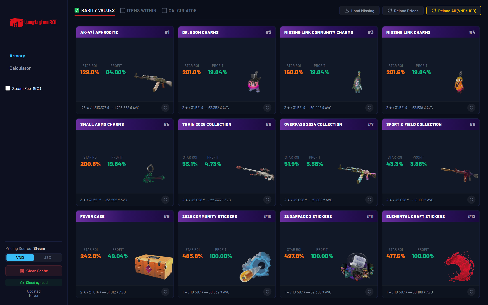
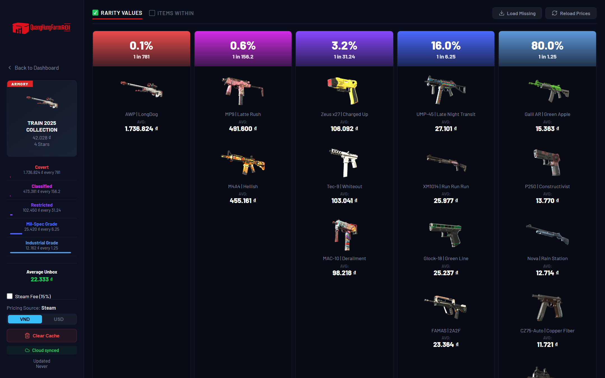
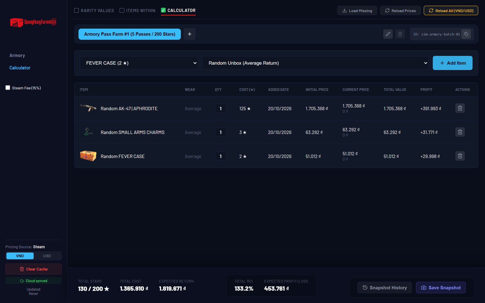

# QuangHungFarm ROI — CS2 Armory Tracker & Pass Simulator

<p align="center">
  
</p>

A web tool I built to track real-time return on investment (ROI) for Counter-Strike 2 Armory Pass collections and simulate multi-pass star spending using live Steam Community Market prices (in both **VND** and **USD**).

---

## Screenshots

### 1. Armory Pass ROI Dashboard
Tracks star cost, expected unboxing value, ROI percentage, and profitable unbox probability across all active Armory collections, charms, cases, and stickers.



### 2. Collection Rarity & Float Breakdown
Breaks down expected value per rarity tier (`Covert`, `Classified`, `Restricted`, `Mil-Spec`, `Industrial`) and calculates weighted average prices based on each skin's actual CS2 float caps (`min_float` to `max_float`).



### 3. Pass Farming & ROI Calculator
Lets you plan or log star redemptions across multiple passes, compare initial vs. current market prices, toggle the 15% Steam market fee, and save historical snapshots.



---

## Why I Built This

Most existing skin trackers only show raw item prices in USD or assume standard float distributions (`0.00 – 1.00`). When farming Armory Passes in Vietnam, two things matter in practice:
1. **Accurate float-capped wear odds:** Many Armory skins have custom float caps (for example `0.00 – 0.50` or `0.08 – 0.80`), which changes the conditional probability of pulling Factory New vs. Field-Tested and shifts the expected value significantly.
2. **Rate-limited Steam API syncing in VND/USD:** Querying hundreds of skin wears directly from the browser hits Steam's rate limits immediately.

### How It Works Under the Hood
* **Custom Float Probability Math (`src/utils/constants.js`):** Computes exact conditional wear weights for any skin's `[min_float, max_float]` range before calculating tier expected values and profit probabilities.
* **Two-Layer Price Cache (`src/hooks/useLocalStorage.js` + `src/supabase.js`):** Reads instantaneously from `localStorage` on startup, syncs in the background with a shared **Supabase** table (`skin_prices_vnd` / `skin_prices_usd`), and batches writes with a 3-second debounce when refreshing missing prices.
* **Rate-Limited Request Queue (`src/api.js` + `api/steam.js`):** Serializes Steam Market price fetches through a Vercel serverless proxy with currency-aware cache keys and automatic cooldown handling.
* **Simulation Snapshots (`src/components/CalculatorView.jsx`):** Supports creating named pass runs, sharing simulations by ID, tracking initial item cost at the time of addition, and storing currency-locked snapshots.

---

## Tech Stack

* **Frontend:** React 19, Vite, React Router v7, Lucide Icons
* **Backend / Cloud Sync:** Vercel Serverless Functions (`api/steam.js`), Supabase (PostgreSQL REST client)
* **Data Pipeline:** Node.js scripts (`generate_data.js`, `patch_float.js`) to pull and patch CS2 collection metadata and float ranges

---

## Running Locally

```bash
# 1. Install dependencies
npm install

# 2. (Optional) Configure Supabase for cloud price syncing
cp .env.example .env
# Add VITE_SUPABASE_URL and VITE_SUPABASE_ANON_KEY if you want shared cloud state.
# Without .env, the app runs in Local-Only mode using localStorage.

# 3. Start the Vite dev server
npm run dev
```
